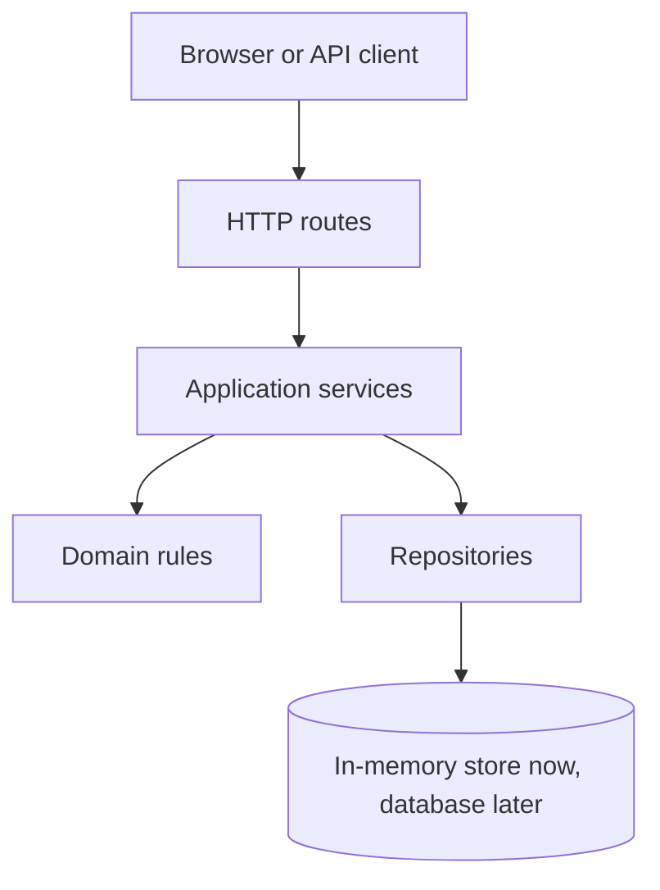
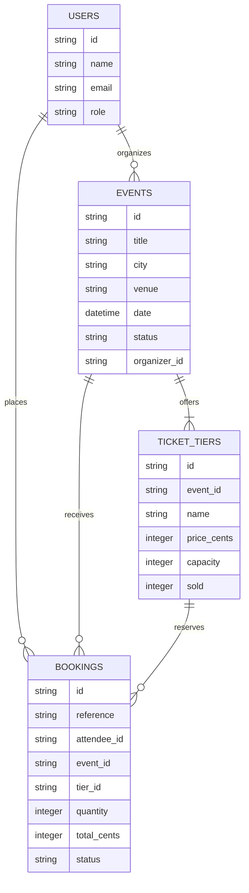
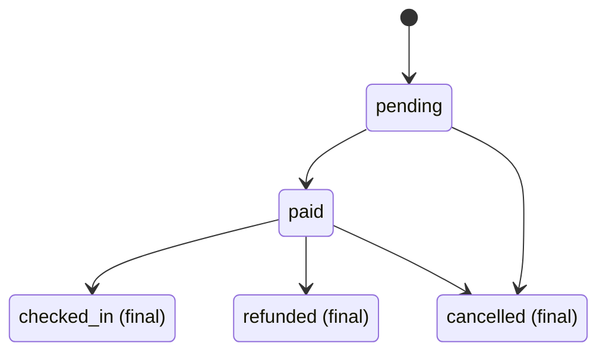

# Application Architecture

## Layers

- **Routes** may validate HTTP-specific input and translate results to HTTP responses; they may not contain business rules or access storage directly.
- **Services** may coordinate domain rules and repositories; they may not depend on HTTP request/response objects or call routes.
- **Domain rules** may enforce business invariants using plain values; they may not perform I/O or depend on services, repositories, or HTTP.
- **Repositories** may read and write data; they may not decide business policy or call services and routes.

## Data Model

## Booking Life Cycle

